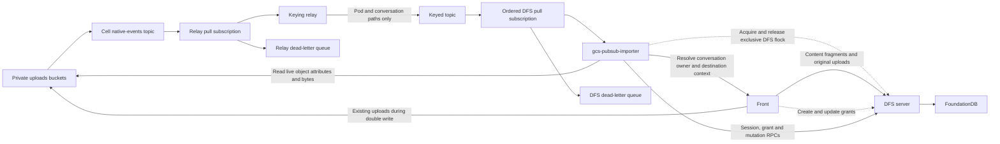

# Writing GCS-backed files to DFS

Two write paths populate DFS. GCS events replicate every file under pod and conversation filesystem folders, including agent writes from the sandbox. Front writes content fragments and original file uploads directly to DFS, alongside the existing GCS write during the double-write phase. Processed versions are excluded from Front's direct DFS writes. These Front writes do not depend on Pub/Sub delivery.

GCS custom metadata carries no DFS grants or replication instructions. Front owns permission resolution and updates DFS grants directly.

## Event flow



GCS publishes native events. The relay selects pod and conversation filesystem paths and republishes those events with an ordering key. `gcs-pubsub-importer` instances validate the same path scope before importing. Events for other paths are ignored and acknowledged. Agents writing files from the sandbox cannot attach custom metadata; their files qualify through the path alone.

The `gcs-pubsub-importer` reads GCS and writes DFS. For conversation files, it calls Front with the workspace and conversation IDs from the path to resolve the conversation owner. The grant subject is `u:<ownerUserSId>`; it must come from Front rather than being inferred from the object name or the agent that wrote it. The `gcs-pubsub-importer` authenticates filesystem writes with its tenant-scoped `superuser` session.

The second topic lets the relay add ordering keys. With unary Pull, ordered delivery allows one outstanding batch per key. This distributes independent work across `gcs-pubsub-importer` instances while serializing each key. It does not restore GCS mutation order. [Pub/Sub ordering](https://docs.cloud.google.com/pubsub/docs/ordering#pull_subscriber_clients).

## Front writes and permission resolution

Content fragments and original file uploads originating in the Front codebase must write to DFS from the Front write path. Front does not write processed versions to DFS. Objects outside pod and conversation filesystem folders will not be picked up by the `gcs-pubsub-importer`. Front resolves the destination and grants from the authenticated workspace and the resource's access rules, writes the bytes to DFS, and records the DFS reference alongside the GCS reference.

For conversation files imported by `gcs-pubsub-importer`, the service uses the owner returned by Front to establish `ALLOW u:<ownerUserSId> rw` when creating the replica. Existing local grants must survive later content imports. Pod files retain the pod's shared permissions through their provisioned directory. Front applies subsequent permission changes directly in DFS; GCS object attributes do not determine grants.

Front and the `gcs-pubsub-importer` can both encounter a file written by Front into a pod or conversation folder. They must agree on one destination object and coordinate updates so an event cannot create a duplicate or overwrite newer contents. The shared mapping, locking and version checks for this overlap remain to be defined. Path filtering cannot distinguish the producer, and custom metadata is not used to do so.

The protocol requires a real parent `ObjectId` and basename to create a file. Destination mapping remains open, as described below. Creation does not accept grants: local grants are applied separately through tenant-key `UpdateGrants`, using `{ grant, remove: false }` to attach and `remove: true` to detach. Restrictive grants must be in place before exposing the file. [Protocol](../protocol/proto/dfs.proto), [grant API](API.md#updategrants).

The `gcs-pubsub-importer` reads live GCS object attributes and the exact generation's bytes rather than trusting an event's older payload. Generation and metageneration are source version checks, not a permission channel.

Front keeps separate GCS and DFS references during double write. A resource's read cutover must wait for a complete DFS write and correct grants. GCS and DFS writes are not atomic; the implementation must define how a successful GCS write with a failed DFS write is recorded and retried. Pub/Sub does not repair Front uploads outside the two folder namespaces. Once DFS owns a resource's contents, pending GCS events must not overwrite or delete it.

## Authorization contract

DFS enforces file access through its grants. Front authorizes access to the conversation URL. The migration must preserve or narrow existing permissions, never enlarge them.

Conversation files follow the conversation's access rules: read access allows reading its files, and write access allows writing them. Front currently gives an accessible conversation a read/write filesystem mount. Pod shared files retain their separate pod read/write checks.

### Conversation folders and URL sharing

Standalone conversation folders live in `/users/{userId}/conversations/`. They inherit **one user grant** from the user directory:

```text
/users/user-U/                            ALLOW u:user-U rw
  conversations/                         no local grants
    conv-C/                              no local grants
      report.csv                         no local grants
```

Sharing C's conversation URL does not itself grant access to its DFS files. There are two choices:

1. **Do nothing.** Another user can open the conversation if Front allows it, but cannot browse its DFS files.
2. **Grant access on first visit.** After the visitor passes Front's conversation checks, Front creates a just-in-time grant on C's folder. The folder appears in the visitor's `/shared`. The grant permits the corresponding conversation file operations and applies only to C.

The proposed choice is option 2. Front authorizes the initial share; DFS enforces subsequent file access. This is the authority tension: if later Front permission changes must revoke that access, Front must also remove or restrict the DFS grant. A successful first visit alone does not handle revocation.

Pod conversations retain their existing pod audience through explicit grants derived from pod access. They are the shared exception to the standalone user-scoped default.

## DFS superuser subject

DFS implements the reserved subject `superuser` for maintenance operations. The `gcs-pubsub-importer` and directory provisioning use normal `CreateSession` with the tenant key and `subjects: ["superuser"]`, then authenticate filesystem operations with the returned session key. The tenant comes exclusively from the authenticated tenant key.

**A `superuser` session has read/write access to every existing real object in its tenant, regardless of grants, including DENYs.** The subject is exact and case-sensitive. It does not grant access to other tenants. The `gcs-pubsub-importer` still validates destinations and acquires the required locks.

**Tenant administration still requires the tenant key.** The `gcs-pubsub-importer` uses it separately for `UpdateGrants`; a `superuser` session cannot authorize tenant-key RPCs. Do not attach ALLOW grants for `superuser`: those grants are invalid, including removals. No additional protocol/server change is needed for this subject. [Session API](API.md#createsession), [protocol](../protocol/proto/dfs.proto).

## Scaling

All `gcs-pubsub-importer` instances use one ordered subscription. Unary Pull allows one outstanding batch per key:

```text
gcs-pubsub-importer 1: A1, A2, A3 — serial
gcs-pubsub-importer 2: B1, B2     — serial, concurrent with A
```

A batch may contain several keys. Serialize each key locally and process different keys concurrently.

## Reconciliation

Events may duplicate or arrive out of order. Each event triggers reconciliation with live GCS state.

1. **Filter.** Recognize the pod and conversation filesystem paths listed below. Ignore objects outside those paths and acknowledge their events. Custom metadata has no role in eligibility or permission resolution.
2. **Lock and check.** Validate the configured bucket, workspace, tenant and destination. Acquire the source's exclusive DFS lock and read live object attributes. For a conversation file, call Front to resolve the owner subject within that workspace. Verify the destination's permissions and compare the completion marker with the live source state. If required ownership or destination context cannot be resolved, do not mark the import complete.
3. **Write.** On first import, create the file under the provisioned directory and durably record its source-to-file mapping. Reuse an existing mapping, including one created by Front. Clear the marker before changing bytes. Read the exact GCS generation, write from offset zero, and set the final size and required file attributes. New conversation files receive the resolved owner's grant; pod files inherit their directory's permissions. Later imports preserve existing grants. Check every operation result before setting the marker.
4. **Unlock and acknowledge.** Acknowledge after a successful write or verified equal state. Failed imports retry.

An authoritative live-object 404 removes an already-mapped replica under the same lock while GCS remains authoritative. If there is no mapped replica, acknowledge without creating anything. An old deletion event must not remove a newer live generation or a file that has switched to DFS ownership.

### Completion marker xattr

```text
front.gcs_sync = {
  "bucket": "private-uploads",
  "objectName": "w/W/pods/P/files/report.csv",
  "generation": "12345",
  "metageneration": "1"
}
```

`front.gcs_sync` records the last complete copy. Matching source, generation and metageneration can skip copying after the permission checks. A missing marker requires a rewrite. Clear it before every attempt, including same-generation retries, so a crash cannot leave partial bytes marked complete.

Writes are direct. The lock serializes `gcs-pubsub-importer` instances; readers that ignore it may see partial contents.

## gcs-pubsub-importer scope and destinations

Every file under either of these recognizable GCS paths is replicated, including files created or overwritten by agents in the sandbox without custom metadata:

| GCS source | DFS destination |
| --- | --- |
| `w/{w}/pods/{p}/files/{path}` | The pod's DFS directory; mapping to its ID remains to be defined. |
| `w/{w}/conversations/{c}/files/{path}` | The conversation's DFS directory; mapping to its ID remains to be defined. |

Other storage paths are outside the event pipeline. Canonical original uploads under `files/w/...`, content fragments and other original Front uploads are written to DFS by Front; canonical processed versions remain in GCS. The folder path rule applies regardless of the file's producer or type, including Frame files and copies of processed versions if they are written inside these namespaces.

The GCS key identifies the workspace, pod or conversation, and relative file path. It does not provide a DFS parent directory ID. We still need to define who provisions those directories and how the `gcs-pubsub-importer` obtains their IDs. The Front lookup for a conversation owner does not by itself resolve that directory mapping. Existing Front integration stores the tenant root ID; pod and conversation directory provisioning is not implemented. The intended layout follows the [DFS URI design](URI.md):

```text
<tenant-root>/users/<userId>/
  pods/pod-<podSId>/
  conversations/conv-<conversationSId>/
```

For example, `w/W/pods/P/files/reports/q3.csv` belongs under P's DFS directory once that mapping exists. Suppose P's directory has:

```text
DENY rw
ALLOW g:G1 r
ALLOW g:G2 rw
```

The `gcs-pubsub-importer` initially creates `reports/` and `q3.csv` with no local grants. They inherit G1 read and G2 read/write. The directory's DENY clears permissions inherited from the containing user folder. No GCS custom metadata is needed.

The source-to-file mapping preserves the DFS file ID across later imports and renames. The `gcs-pubsub-importer` does not copy the directory's grants onto each file. A pod path identifies the pod rather than the conversation that produced a sandbox write, so pod permissions come from the pod context. The Front lookup and directory provisioning interface for that context remain to be defined.

## Backfill

The folder backfill enumerates all existing files in the pod and conversation namespaces and schedules reconciliation through the same import path as live events. Conversation files use the Front owner lookup; pod files use the provisioned pod directory's permissions. The backfill does not stamp or read custom grant metadata.

Historical content fragments and original Front uploads require a separate Front-driven backfill using their resource records to determine destinations, grants and DFS references. Processed versions are excluded from this backfill. Enumerating folder events alone cannot migrate these files. Its resource coverage and execution plan remain to be defined.

Directory provisioning, direct Front writes and both backfill paths use Front's permission model. Directory permissions must be in place before importing files that inherit them. A failed owner lookup must not silently fall back to another subject or be acknowledged as a completed import.

## Destination grants

Directory grants carry shared permissions. Conversation imports resolve the owner through Front and establish the owner grant described above. Pod files inherit pod directory grants. Front writes any additional file-local grants directly to DFS. Later content imports preserve those grants and must not replace directory sharing permissions.

| Actor | DFS access |
| --- | --- |
| `superuser` session | Read/write access to every existing real object within one tenant, regardless of grants. Issued through tenant-key `CreateSession`. |
| User `u:<userId>` | Access inherited from the user's directory or explicitly granted on a shared context. |
| Group `g:<groupId>` | Access derived from the existing Front group's applicable permissions. |

Front uses its existing permission checks when provisioning directories, resolving owners and writing uploads and grants to DFS. User and group subjects must retain the caller's actual scope. In particular, scoped API keys or sandbox sessions must not gain broader access through a user subject.

### Conversation files

Front's current conversation checks determine the pod audience and authorize a JIT share:

| Conversation | Front access check |
| --- | --- |
| Pod conversation (`spaceId` set) | The pod exists and the caller can read it. Additional `requestedSpaceIds`, participation and private-by-default URL settings do not add visibility restrictions. |
| Standalone conversation (`spaceId` null, `depth === 0`) | The caller can read every requested space. When private-by-default URL restrictions apply with `participants_only` mode, participation is also required. |
| Sub-conversation without a pod | Required-space checks still apply. Front exempts it from the private-by-default URL restriction. |

Missing or inaccessible required resources deny access. An invitation to a standalone conversation does not bypass its requested-space checks. Front's explicit support-user and auth-method exceptions do not grant ordinary sessions an administrative bypass. [Conversation authorization](../../front/lib/resources/conversation_resource.ts).

File write permissions differ between the two mounts:

| Files | Read | Write |
| --- | --- | --- |
| Conversation files | Conversation access | Conversation access; Front currently makes this mount read/write. |
| Pod shared files | Pod read | Pod write. |

A pod reader can therefore write conversation-mounted files while only reading pod shared files. This follows `ConversationResource.canAccess`, `createConversationMount` and `createPodMount`. [Access check](../../front/lib/resources/conversation_resource.ts#L1405), [mount permissions](../../front/lib/api/file_system/dust_file_system.ts#L114).

For standalone C, a JIT grant is attached to C's folder, leaving the owner's inherited grant intact. The visitor discovers C through `/shared` and gains no access to the owner's other conversations. Do not pre-grant access to every potential URL viewer.

### Uploads copied into a pod or conversation

Front writes an upload's canonical original to DFS as part of its upload flow. The canonical processed version remains in GCS. Both `files/w/{w}/{f}/{original,processed}` GCS paths remain outside event replication.

Copies into a pod or conversation filesystem are separate destination files with that context's permissions. Front-created copies of originals must also be written to DFS by Front. Their GCS paths additionally qualify for the `gcs-pubsub-importer`, so both paths must reuse the same destination mapping and coordinate version checks. Copies of processed versions in these folders reach DFS only through the event pipeline, as do sandbox-created files and copies. Attaching an upload must not move its canonical DFS object or carry unrelated source grants into the destination.

## Validation

Check that the relay and `gcs-pubsub-importer` restrict event replication to pod and conversation filesystem paths, including sandbox-created files. Custom metadata must not affect eligibility or grants. Verify that conversation imports resolve the owner through Front, pod imports preserve pod permissions, and failed or cross-workspace lookups cannot produce completed imports. Later content imports must preserve existing grants.

Verify that content fragments and original Front uploads write bytes, grants and references to DFS without relying on Pub/Sub. Check that Front direct writes and the Front-driven backfill exclude processed versions, while copies under pod and conversation folders still qualify for event replication. Cover original copies, partial double-write failures and retries. For Front writes into replicated folders, test that concurrent event delivery neither creates duplicates nor overwrites newer contents. Verify both backfill paths.

Compare pod and conversation access with Front's existing checks. Verify owner grants, JIT sharing through `/shared`, tenant isolation, duplicate/reordered events and the handoff from GCS-owned contents to DFS-owned contents. Front permission changes must update DFS directly throughout the migration.
