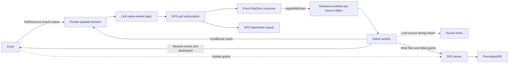

# GCS replication into DFS

Replicate the live files in pod and conversation GCS folders into DFS. `FileResource` already copies attached uploads into these folders. The importer handles those copies and sandbox writes through the same Pub/Sub subscription; Front does not need a second content write to DFS.

GCS remains the source of truth until a file switches to DFS. Replication is asynchronous and can skip intermediate versions. Front resolves permissions and updates DFS grants directly. GCS custom metadata does not carry grants.

## Scope

| GCS source                                                    | DFS destination                                                |
| ------------------------------------------------------------- | -------------------------------------------------------------- |
| `w/{workspaceId}/pods/{podId}/files/{path}`                   | `users/{userSId}/pods/{podName}/{path}` under the tenant root. |
| `w/{workspaceId}/conversations/{conversationId}/files/{path}` | The conversation's DFS directory.                              |

Import every file in these folders, including original uploads, processed copies and Frame files. Acknowledge events for other paths without importing them. Canonical uploads under `files/w/...` remain in GCS; their mount copies are imported.

Sandbox function bundles use a separate `sandbox-functions/` prefix and are outside this rollout. See [`resolveProjectMountPath()`](../../front/lib/resources/file_resource.ts#L1874).

## Existing copies in FileResource

[`FileResource.copyMountFiles()`](../../front/lib/resources/file_resource.ts#L1984) copies the original into its GCS mount path:

```ts
const srcOriginalPath = this.getCloudStoragePath(auth, "original");
await bucket.copyFile(srcOriginalPath, mountFilePath);
```

It also copies the processed version when `getProcessedMountFilePath()` returns a path. Each successful GCS copy emits a finalize event for the destination. [GCS event types](https://docs.cloud.google.com/storage/docs/pubsub-notifications#event_types).

| Entry point                                                                        | Behavior                                                                                                  |
| ---------------------------------------------------------------------------------- | --------------------------------------------------------------------------------------------------------- |
| [`markAsReady()`](../../front/lib/resources/file_resource.ts#L990)                 | Resolves and copies the mount file when processing marks an upload ready.                                 |
| [`setUseCaseMetadata()`](../../front/lib/resources/file_resource.ts#L1781)         | Resolves and copies the mount file when the file is attached, including an upload that was already ready. |
| [`resolveAndSetMountFilePath()`](../../front/lib/resources/file_resource.ts#L1811) | Selects the conversation or pod path, claims it, then calls `copyMountFiles()`.                           |

[`maybeUpsertFileAttachment()`](../../front/lib/api/files/attachments.ts#L20) binds an unattached conversation upload through `setUseCaseMetadata()`. [`toFileContentFragment()`](../../front/lib/api/assistant/conversation/content_fragment.ts#L91) creates a conversation `FileResource` for inline content; processing then calls [`markAsReady()`](../../front/lib/api/files/processing/index.ts#L637). Content-node references without a file are outside this replication scope.

[`uploadContent()`](../../front/lib/resources/file_resource.ts#L1727) writes edits to the existing GCS mount path. Its temporary dual-write comment refers to the canonical and mount objects within GCS. Frames created directly at a mount path are covered by the same events.

`markAsReady()` sets the ready status before copying and returns early on an already-ready file. Retrying that method alone does not repair a failed copy. Mount-copy recovery must retry the copy itself; Pub/Sub cannot import an object that was never copied.

## Event flow



Use one native topic and one pull subscription. A Front consumer hands events to Temporal. One workflow per `(tenant, bucket, objectName)` schedules imports for that source. Independent objects can be imported concurrently. No keying relay or ordered topic is needed.

### Front consumer

Run the pull subscription consumer in a standalone Node process in `front`. Configure the full subscription name, expected bucket and notification configuration. Validate messages before handing them to Temporal.

The consumer checks the `dfs_gcs_replication` feature flag for the workspace in `w/{workspaceId}/...`. It acknowledges objects outside the supported prefixes and objects whose workspace has the flag disabled, without starting a workflow. Flag lookup failures are retried. The import activity checks the flag again on every attempt. Enabling the flag requires a backfill for objects whose events or activities were already skipped. Disabling it prevents new imports once the change is visible to the flag lookup. Imports already running may finish.

For an enabled workspace, call `signalWithStart` with a stable workflow ID derived from the source key. Acknowledge the Pub/Sub message only after Temporal accepts the signal. A failed or ambiguous handoff is nacked. Redelivery may signal twice, which must be harmless. Invalid messages are nacked and eventually reach the Pub/Sub dead-letter queue. [Temporal message passing](https://docs.temporal.io/encyclopedia/workflow-message-passing).

Limit concurrent handoffs to eight. On shutdown, stop accepting messages, allow 30 seconds for handoffs to drain, then leave unfinished deliveries unacknowledged. Pub/Sub client shutdown has a 60-second limit. Imports continue independently in Temporal.

### Temporal imports

The signal marks the source as needing an import. The workflow runs one import activity at a time. Signals received during an activity require another pass after it finishes. Coalesce those signals into one pending pass. Do not choose a generation from the last delivered event: notification order does not identify the current GCS state.

The workflow completes when there is no pending pass, without awaiting more work between that check and completion. A later `signalWithStart` starts a new execution with the same workflow ID. For continuously updated objects, use Continue-As-New after an activity completes and history reaches the SDK's suggested limit. Carry pending work into the new execution. Workflow arguments contain source identifiers only, never file bytes or GCS credentials. [Entity workflows](https://docs.temporal.io/design-patterns/entity-workflow).

Each activity attempt has a 30-minute start-to-close timeout and a 60-second heartbeat timeout, with heartbeats every 20 seconds. Retry failures with exponential backoff capped at one minute. Alert on sustained retries and stalled workflows. Cancellation must reach the GCS stream and DFS requests. Heartbeats report activity liveness, not successful import completion. A timed-out activity may still be running, so the DFS lease and fencing checks below remain required. [Activity failure detection](https://docs.temporal.io/encyclopedia/detecting-activity-failures), [TypeScript activity cancellation](https://typescript.temporal.io/api/namespaces/activity).

Before activation, implement the fenced DFS importer, bind it to the Temporal activity, register the worker, and add the Pub/Sub process entrypoint and deployment configuration. The importer must acquire the source lock, resolve permissions and destination IDs, write DFS, and record completion before returning success. The Front-only PR can prepare the consumer and Temporal orchestration while this DFS support is pending.

### Notifications and preconditions

Configure `JSON_API_V1` payloads and subscribe to `OBJECT_FINALIZE`, `OBJECT_METADATA_UPDATE`, `OBJECT_DELETE`, and `OBJECT_ARCHIVE` (when versioning is enabled). Attributes include `bucketId`, `objectId`, and `objectGeneration`; the payload includes `metageneration`. GCS provides at-least-once publication after activation. Notifications can duplicate or arrive out of order, with no delivery-time SLA. [GCS notifications](https://docs.cloud.google.com/storage/docs/pubsub-notifications).

Treat each notification as a request to reconcile the source. Read the live object's metadata, then fetch its bytes with both returned versions as preconditions:

```http
GET /storage/v1/b/{bucket}/o/{encodedObjectName}?alt=media&ifGenerationMatch={g}&ifMetagenerationMatch={m}
```

A successful request returns bytes matching the metadata read. If DFS already has a complete copy of generation `g`, reuse those bytes. A mismatch returns `412` and the activity retries from current metadata. A disappearance between metadata and content reads also requires a retry. [GET API](https://docs.cloud.google.com/storage/docs/json_api/v1/objects/get), [preconditions](https://docs.cloud.google.com/storage/docs/request-preconditions).

Do not add `generation=g` to this live-object check: that parameter selects a retained revision, which may be noncurrent. GCS does not retain historical metadata that can be fetched by metageneration. [GET API](https://docs.cloud.google.com/storage/docs/json_api/v1/objects/get), [metadata history](https://docs.cloud.google.com/storage/docs/object-versioning#noncurrent_object_metadata).

Using the event's versions directly would allow skipping a `412` only if another notification covers the replacement state. Reading current metadata on every pass removes that dependency. A metadata event can create a missing replica, and a late delete event can import a replacement object.

## Concurrency

All workers, backfills, repair jobs and the switch to DFS must use the same exclusive lock for `(tenant, bucket, objectName)`. Acquire it before reading GCS and hold it through file creation, writes, initial grants and the completion marker. The lock key must exist before the DFS file and survive its deletion.

Use a renewable lease with an initial duration of 60 seconds and renew it every 20 seconds while the import is active. The lock service determines expiry. A crashed worker stops renewing, so another worker can acquire the lock after the last lease expires. A busy lock fails the activity attempt for retry. This lease is independent of Pub/Sub's acknowledgment deadline and Temporal's heartbeat timeout.

Each acquisition returns a newer fencing token for that source. Every DFS mutation, including deletion, grants and the completion marker, must verify that token and the active lease atomically with the mutation. DFS must reject writes from an expired or replaced holder. The token sequence must survive lease expiry and file deletion so an old token cannot become valid again.

If renewal fails or times out, stop the transfer and DFS writes and fail the activity attempt. Do not report success after losing the lease. Renew only a matching, unexpired lease. Release only when the holder and token still match, so a delayed request cannot release a replacement worker's lease. Release after all writes finish or on cancellation when possible. Otherwise let the lease expire. The lock API and storage remain to be implemented.

The current DFS protocol has no lock or conditional-write operation. Front's Redis lock expires and does not fence DFS writes. Neither is sufficient to run the importer safely today.

A GCS precondition only protects the read. Without the lock, worker A can fetch version A, stall while worker B copies version B into DFS, then overwrite B with A. Both reads passed their preconditions, and no further event need arrive. A GCS recheck before an unlocked DFS write still leaves this race.

## Import procedure

1. **Filter and lock.** Revalidate the source workspace and check `dfs_gcs_replication`. Take the source lock. If the file has switched to DFS, complete without changing it.
2. **Read GCS.** Read current live metadata, then fetch content with the generation and metageneration preconditions above. If it changes or disappears between requests, retry the activity from live metadata.
3. **Resolve the destination.** Reuse the stored source-to-file mapping. On first import, obtain the parent directory ID and required grants from Front. Fail if the destination or conversation owner cannot be resolved in the source workspace. A retry after file creation must recover the same file even if the worker failed before saving its mapping.
4. **Write.** Clear the completion marker before changing the file. Copy content from offset zero when the generation differs or no complete copy exists. Set the final size and required attributes. Apply initial grants before exposing a new file, including when recovering an incomplete creation. Preserve grants on later imports. Set the marker only after every operation and the full content transfer succeeds.
5. **Complete.** Return success for completed imports, verified unchanged files and files already managed by DFS. Retry failures. An incomplete file update must leave the marker absent. If the activity result is lost, keep the completed marker so the retry can skip the write. Pub/Sub was already acknowledged at the Temporal handoff.

Handle read results as follows:

| Result                                                          | Action                                                                                                           |
| --------------------------------------------------------------- | ---------------------------------------------------------------------------------------------------------------- |
| `412` or `404` on the conditional content read                  | Retry from current metadata. Do not apply the earlier metadata or partial bytes.                                 |
| `404` on the live metadata read                                 | Delete the mapped replica under the source lock while GCS remains authoritative. If no replica exists, complete. |
| Access error, throttling, service error or interrupted transfer | Fail the activity attempt for Temporal to retry. Never treat it as deletion.                                     |

Delete/archive events must check the live object because a replacement also emits an event for the displaced generation. A stale delete must not remove a newer replica. [GCS event types](https://docs.cloud.google.com/storage/docs/pubsub-notifications#event_types).

GCS reads are strongly consistent after writes, metadata updates and deletes. The lock orders DFS imports; it does not prevent new GCS writes during an import. Later events bring DFS up to date. [GCS consistency](https://docs.cloud.google.com/storage/docs/consistency).

### Completion marker

```text
front.gcs_sync = {
  "bucket": "private-uploads",
  "objectName": "w/W/pods/P/files/report.csv",
  "generation": "12345",
  "metageneration": "1"
}
```

Store this JSON as UTF-8 bytes in the file's `front.gcs_sync` xattr. The marker records a complete import. After checking the live source, matching all four fields allows a skip. A matching source and generation with a different metageneration allows reuse of complete bytes. Also compare the DFS file size with the live GCS size before reusing bytes. A missing marker requires a full rewrite. Clear it before content or attribute changes, including retries of the same generation.

Copy the stored bytes without decompression. Verify the transferred size and CRC32C when GCS supplies it. Store the content encoding in `front.gcs_content_encoding`, and apply the MIME type and GCS update time to the DFS file. Preserve other xattrs. A malformed completion marker or one naming another source fails the import for investigation.

DFS `Apply` returns per-operation errors and can commit other operations in the batch. Clear the marker in its own checked request. After the transfer succeeds, set the attributes and completion marker in one `Update` operation, which validates the whole patch before writing. Do not put that final update in a batch with writes that can fail independently.

Keep generation and metageneration values lossless and compare generations for equality. Generation numbers are not guaranteed to increase; taking their numeric maximum cannot reject stale events. Metageneration increases only within one generation. [Generation semantics](https://docs.cloud.google.com/storage/docs/metadata#generation-number).

DFS writes modify the destination file directly. Readers that do not take the lock may see partial contents.

## Destination mapping

The GCS path supplies the workspace, pod or conversation ID, and relative path. DFS creation requires a parent `ObjectId` and basename. Front's [folder helpers](../../front/lib/api/dfs/folders.ts) create and store user, pod and conversation folder IDs using the [DFS URI layout](URI.md). The importer should reuse those helpers.

Pod directories in DFS use the pod's actual name (`SpaceResource.name`) unchanged. Resolve the pod ID from the GCS path within its workspace, then use its stored DFS folder ID. On first creation, create `pods/{podName}` under the owner's user folder with that exact name. URI percent-encoding preserves the name; it does not change the stored basename. DFS basename limits still apply.

GCS paths, source locks and completion markers continue to use the pod ID. Later imports use the stored DFS folder ID, so a directory rename or move preserves the mapping. Front must handle pod renames by updating the existing directory's name and `dust.display_name`; a pod rename does not produce a GCS object event.

The current [`podFolderName()` helper](../../front/lib/dfs/folders.ts) rewrites names and falls back to a pod ID. It needs to be updated to preserve the actual name. The folder helpers also do not handle pod renames or name collisions. Folder creation must distinguish recovery for the same pod from another pod with the same name before imports are enabled. Pod grant propagation remains unfinished, and interrupted folder creation needs to recover its initial grants before files are exposed.

Store one mapping from the source object to its DFS file ID and reuse it for later imports. Mapping storage and recovery after interrupted creation remain to be defined. Preserving a DFS ID across a GCS rename also needs an explicit mapping update; separate copy and delete notifications do not establish that relationship.

## Permissions

Front resolves the conversation owner and pod permissions from the authenticated workspace. New conversation files receive `ALLOW u:<ownerUserSId> rw`; the importer must not infer this subject from the object name or writer. Pod files inherit their directory's grants. Later imports preserve file-local grants maintained by Front. GCS custom metadata has no effect on access.

The importer uses a tenant-key `CreateSession` with `subjects: ["superuser"]` for filesystem writes. This subject has read/write access to real objects in that tenant, including through DENYs. `UpdateGrants` still requires the tenant key. Do not attach grants for `superuser`; they are invalid. [Session API](API.md#createsession), [protocol](../protocol/proto/dfs.proto).

File creation does not accept grants. Apply them separately with `UpdateGrants` using `remove: false` to attach and `remove: true` to detach. Required access restrictions must be in place before a file is accessible. A failed owner lookup or grant update must not produce a completed import. [Grant API](API.md#updategrants).

For example, a pod directory with these grants passes its access rules to files created without local grants:

```text
DENY rw
ALLOW g:G1 r
ALLOW g:G2 rw
```

The DENY clears inherited access; G1 receives read access and G2 read/write access. Do not copy the directory's grants onto each file.

### Conversation sharing

A standalone conversation directory inherits the owner's user grant:

```text
/users/user-U/                            ALLOW u:user-U rw
  .conversations/                        no local grants
    conv-C/                              no local grants
```

When someone visits a shared conversation, Front first checks conversation access, then grants access to that conversation's DFS directory. It appears in the visitor's `/shared`. This must not grant access to the owner's other conversations. Later Front permission changes must update or revoke the DFS grant. Pod conversations retain the pod's audience.

Use Front's current access checks:

| Conversation                                            | Required access                                                                                                            |
| ------------------------------------------------------- | -------------------------------------------------------------------------------------------------------------------------- |
| Pod conversation (`spaceId` set)                        | The pod exists and the caller can read it. Extra requested spaces and standalone URL restrictions do not apply.            |
| Standalone conversation (`spaceId` null, `depth === 0`) | The caller can read every requested space. Private-by-default URLs in `participants_only` mode also require participation. |
| Sub-conversation without a pod                          | Required-space checks still apply; the private-by-default URL restriction does not.                                        |

Missing or inaccessible resources deny access. An invitation does not bypass requested-space checks. Preserve existing support-user and auth-method exceptions without widening ordinary callers' permissions. [Conversation access](../../front/lib/resources/conversation_resource.ts#L1406).

Front currently gives an accessible conversation a read/write filesystem mount. Pod shared files require pod read access for reads and pod write access for writes. A pod reader can therefore write conversation files while only reading pod shared files. Preserve those rules and the caller's scope, including scoped API keys and sandbox sessions. [Mount permissions](../../front/lib/api/file_system/dust_file_system.ts#L114).

## Backfill and recovery

Create the subscription and enable notifications before backfill. GCS notification activation can take 30 seconds. Include that window in the scan. Monitor publication failures: GCS may remove the notification after seven days of persistent delivery failure. [Delivery guarantees](https://docs.cloud.google.com/storage/docs/pubsub-notifications#delivery_guarantees).

List existing files in the two folders and signal the same per-source Temporal workflows. Resolve conversation owners and use the provisioned pod directory grants. Do not add grant metadata to GCS objects.

For legacy attachments with no mount copy, the existing [`ensureMountFilePath()` helper](../../front/scripts/backfill_mount_helpers.ts#L73) copies canonical files into GCS. It overwrites existing mount objects, so do not run it over live edited files. Recover missing copies before expecting Pub/Sub delivery; restoring a missing processed sibling must also preserve the live original.

Replay the Pub/Sub dead-letter queue for failures before handoff. After handoff, monitor and recover imports in Temporal, including failed or terminated workflows. Run periodic repair scans over both live GCS objects and stored mappings to repair missed updates and deletes. Pub/Sub can discard unacknowledged messages after the retention period. [Subscription retention](https://docs.cloud.google.com/pubsub/docs/subscription-properties#message_retention_duration).

## Switching to DFS

Keep GCS and DFS references during migration. Switch reads only after a complete import with correct grants. Take the source lock when switching content ownership so an in-flight import cannot overwrite a subsequent DFS write. After the switch, pending GCS events must not modify or delete the DFS file.

## Validation

Check these cases before enabling replication:

- Original uploads, uploads attached after processing, file-backed content fragments, processed copies and sandbox-created files all reach DFS through GCS events. Other prefixes are ignored.
- Duplicate and reordered events, including replacement generations whose numeric values decrease, leave the current state in DFS.
- A crash before handoff causes Pub/Sub redelivery. A crash after Temporal accepts the signal but before acknowledgment can signal twice without losing the import.
- Signals during an import schedule another pass. Signals racing with workflow completion or Continue-As-New are preserved. Sustained traffic does not grow one history indefinitely.
- An event for `(g,1)` imports current metadata `(g,2)`. A `412` or `404` between metadata and content reads retries from current state.
- A worker crashes while holding the lock. Its lease expires and a retry can acquire the same source lock without manual cleanup. Imports longer than one lease succeed while renewal continues.
- An activity times out after a successful GCS read and its lease expires. A replacement activity imports the file. DFS rejects the old activity's writes, and its delayed renewal or release cannot change the replacement lease. A renewal timeout fails the attempt.
- Concurrent first imports and retries after creation reuse one file. Deletion/recreation uses the same source lock.
- Pod files land in a directory with the pod's exact name. Renames preserve its DFS folder ID and source mappings. Different pods with the same name cannot share a directory.
- An old delete/archive event leaves a newer live object intact. A missing historical revision does not delete its live replica.
- Interrupted content, attribute and initial-grant writes leave no completion marker. Retries complete the import without resetting later Front grants.
- Failed mount copies, dead-lettered handoffs, failed workflows and missed deletes are recovered. Mount-copy repair preserves live edits.
- Tenant isolation, owner grants, pod permissions and conversation sharing match Front's checks. Failed or cross-workspace lookups cannot create completed imports.
- The switch to DFS waits for the importer and prevents pending GCS events from changing DFS-owned files.

## Implementation status

Checked against DFS on `main` at `acdc44a2e8` and the Front worker branch.

### Available

| Piece              | Existing implementation                                                                                                             | Use for replication                                                                                                                                                          |
| ------------------ | ----------------------------------------------------------------------------------------------------------------------------------- | ---------------------------------------------------------------------------------------------------------------------------------------------------------------------------- |
| File operations    | [`DfsClient`](../../front/lib/dfs/client.ts), [`DfsFileSystem`](../../front/lib/dfs/file_system.ts)                                 | Stat with metadata, streamed writes to an existing ID, truncation and removal. Writes are split below the 4 MiB RPC limit.                                                   |
| Xattrs             | [`UpdateOperation`](../protocol/proto/dfs.proto), [`apply_update`](../server/src/storage/resources/object/apply.rs)                 | Add or remove individual keys without replacing unrelated xattrs. The total key/value budget is 32 KiB. One update validates its entire patch before writing.                |
| Tenant credentials | [`DfsTenantResource`](../../front/lib/resources/dfs_tenant_resource.ts), [`getDfsTenantClient`](../../front/lib/api/dfs/clients.ts) | Fetch the authenticated workspace's tenant key from OAuth and share one gRPC transport per process.                                                                          |
| Folder IDs         | [`getOrCreate*Folder`](../../front/lib/api/dfs/folders.ts)                                                                          | Stored IDs for users, pods and conversations. Reuse the stored folder after a rename or move.                                                                                |
| GCS reads          | [`readGcsReplicationSource`](../../front/lib/api/dfs/gcs_source.ts)                                                                 | Read live metadata, open media with both preconditions, preserve gzip bytes, validate size and CRC32C.                                                                       |
| File import        | [`importGcsSourceToDfsFile`](../../front/lib/api/dfs/gcs_import.ts)                                                                 | Import into a prepared, mapped file. Skip complete copies, update metadata, rewrite incomplete copies and delete on live metadata 404. Preserve grants and unrelated xattrs. |
| Event processing   | [`gcs_worker.ts`](../../front/lib/api/dfs/gcs_worker.ts), [`dfs_gcs_replication`](../../front/temporal/dfs_gcs_replication)         | Validate events and workspace flags, acknowledge after Temporal handoff, serialize attempts and retry failures.                                                              |

The file import function requires an existing target ID and parent ID. It does not resolve or create the target, acquire a lease or establish grants. It is not bound to the Temporal activity. Its caller must provide those guarantees before it can run in production.

### Missing before activation

1. **DFS leases and fencing.** No acquire, renew or release API exists. `Apply` and `UpdateGrants` accept no lease token or mutation precondition. Implement the source lease in DFS and validate it in the same transaction as every mutation. Redis locks and cancellation checks between requests cannot enforce this.
2. **Source mapping and creation recovery.** Front stores folder IDs but no `(workspace, bucket, objectName)` to file ID mapping. Persist the file ID, its parent and whether GCS or DFS owns the content. Define recovery across a crash between reserving an ID, creating the file and storing the mapping. DFS requires a creation UUIDv7 no more than five minutes old, so a stale reservation cannot simply be retried forever. The completion xattr is not a reverse index and is absent during an incomplete import. `Search` returns `UNSUPPORTED` today. DFS transaction receipts only cover retries within one server invocation, not a later Temporal attempt.
3. **Folder identity and grants.** `podFolderName()` still rewrites the pod name. Existing folder creation can reuse a different pod's same-name directory. User-folder recovery skips initial grants when the directory already exists, including after an earlier grant failure. Pod member grants are still a TODO. Fix these before using the helpers for imports, preserve the actual pod name, and handle renames independently of GCS events.
4. **Importer session authorization.** DFS supports the `superuser` subject. The `createDfsSuperuserSession()` helper added on `main` restricts its use to user and pod context-folder creation through its `superuser-session-uses` contract. This conflicts with the replication session described above. Resolve that contract for an internal importer session before binding the activity. An ordinary user session does not guarantee access to all replicated files.
5. **Request cancellation.** The GCS transfer accepts cancellation. The DFS transport has a 30-second deadline but no `AbortSignal` or call cancellation. The import function checks cancellation before and after mutations, including each content chunk. Add cancellation to the client/transport while keeping server fencing as the protection against requests already admitted.
6. **Activity and deployment wiring.** Bind the importer only after target resolution and fencing exist. Register the Temporal worker, add the Pub/Sub consumer entrypoint, and provision subscriber identity, subscriptions and deployment configuration in `dust-infra`.
7. **Ownership switch and repair.** Implement the GCS-to-DFS ownership transition under the same lease. Add backfill and repair over live GCS objects and stored mappings, plus recovery for mount copies that never reached GCS. A disabled workspace flag can discard events, so enabling it needs a backfill.

The importer tests use the real GCS SDK against a local HTTP server, the existing DFS filesystem helper and the in-memory DFS implementation. They cover content and metadata updates, xattrs, deletion, cancellation and retry behavior. They do not validate the DFS server, initial grants, destination creation or fencing. The separate live GCS/Pub/Sub/Temporal test exercised delivery and GCS reads without DFS mutations.
