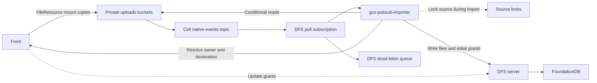

# GCS replication into DFS

Replicate the live files in pod and conversation GCS folders into DFS. `FileResource` already copies attached uploads into these folders. The importer handles those copies and sandbox writes through the same Pub/Sub subscription; Front does not need a second content write to DFS.

GCS remains the source of truth until a file switches to DFS. Replication is asynchronous and can skip intermediate versions. Front resolves permissions and updates DFS grants directly. GCS custom metadata does not carry grants.

## Scope

| GCS source | DFS destination |
| --- | --- |
| `w/{w}/pods/{p}/files/{path}` | The pod's DFS directory. |
| `w/{w}/conversations/{c}/files/{path}` | The conversation's DFS directory. |

Import every file in these folders, including original uploads, processed copies and Frame files. Acknowledge events for other paths without importing them. Canonical uploads under `files/w/...` remain in GCS; their mount copies are imported.

Sandbox function bundles use a separate `sandbox-functions/` prefix and are outside this rollout. See [`resolveProjectMountPath()`](../../front/lib/resources/file_resource.ts#L1874).

## Existing copies in FileResource

[`FileResource.copyMountFiles()`](../../front/lib/resources/file_resource.ts#L1984) copies the original into its GCS mount path:

```ts
const srcOriginalPath = this.getCloudStoragePath(auth, "original");
await bucket.copyFile(srcOriginalPath, mountFilePath);
```

It also copies the processed version when `getProcessedMountFilePath()` returns a path. Each successful GCS copy emits a finalize event for the destination. [GCS event types](https://docs.cloud.google.com/storage/docs/pubsub-notifications#event_types).

| Entry point | Behavior |
| --- | --- |
| [`markAsReady()`](../../front/lib/resources/file_resource.ts#L990) | Resolves and copies the mount file when processing marks an upload ready. |
| [`setUseCaseMetadata()`](../../front/lib/resources/file_resource.ts#L1781) | Resolves and copies the mount file when the file is attached, including an upload that was already ready. |
| [`resolveAndSetMountFilePath()`](../../front/lib/resources/file_resource.ts#L1811) | Selects the conversation or pod path, claims it, then calls `copyMountFiles()`. |

[`maybeUpsertFileAttachment()`](../../front/lib/api/files/attachments.ts#L20) binds an unattached conversation upload through `setUseCaseMetadata()`. [`toFileContentFragment()`](../../front/lib/api/assistant/conversation/content_fragment.ts#L91) creates a conversation `FileResource` for inline content; processing then calls [`markAsReady()`](../../front/lib/api/files/processing/index.ts#L637). Content-node references without a file are outside this replication scope.

[`uploadContent()`](../../front/lib/resources/file_resource.ts#L1727) writes edits to the existing GCS mount path. Its temporary dual-write comment refers to the canonical and mount objects within GCS. Frames created directly at a mount path are covered by the same events.

`markAsReady()` sets the ready status before copying and returns early on an already-ready file. Retrying that method alone does not repair a failed copy. Mount-copy recovery must retry the copy itself; Pub/Sub cannot import an object that was never copied.

## Event flow



Use one native topic and one importer subscription. Workers filter paths and serialize each source object's imports with a distributed exclusive lock. Independent objects can be imported concurrently. No keying relay or ordered topic is needed once this locking is implemented.

### Notifications and preconditions

Configure `JSON_API_V1` payloads and subscribe to `OBJECT_FINALIZE`, `OBJECT_METADATA_UPDATE`, `OBJECT_DELETE`, and `OBJECT_ARCHIVE` (when versioning is enabled). Attributes include `bucketId`, `objectId`, and `objectGeneration`; the payload includes `metageneration`. GCS provides at-least-once publication after activation. Notifications can duplicate or arrive out of order, with no delivery-time SLA. [GCS notifications](https://docs.cloud.google.com/storage/docs/pubsub-notifications).

For finalize and metadata-update events, read the live object with both event versions as preconditions:

```http
GET /storage/v1/b/{bucket}/o/{encodedObjectName}?alt=media&ifGenerationMatch={g}&ifMetagenerationMatch={m}
```

A successful request validates the event's metadata and returns matching bytes. The importer can use that metadata without a separate metadata GET. If DFS already has a complete copy of generation `g`, omit `alt=media` and check metadata only. A mismatch returns `412`. [GET API](https://docs.cloud.google.com/storage/docs/json_api/v1/objects/get), [preconditions](https://docs.cloud.google.com/storage/docs/request-preconditions).

Do not add `generation=g` to this live-object check: that parameter selects a retained revision, which may be noncurrent. GCS does not retain historical metadata that can be fetched by metageneration. [GET API](https://docs.cloud.google.com/storage/docs/json_api/v1/objects/get), [metadata history](https://docs.cloud.google.com/storage/docs/object-versioning#noncurrent_object_metadata).

A `412` means the event no longer matches the live object. Skipping it is safe only if the change that replaced it is covered by the subscription and successfully processed. That event may already have been handled. In particular, if finalize `(g,1)` is skipped after metadata reaches `(g,2)`, the metadata event must create the replica and copy its bytes if needed.

## Concurrency

All workers, backfills, repair jobs and the switch to DFS must use the same exclusive lock for `(tenant, bucket, objectName)`. Acquire it before reading GCS and hold it through file creation, writes, initial grants and the completion marker. The lock key must exist before the DFS file and survive its deletion. DFS must reject writes from a worker that has lost the lock. The lock implementation remains to be defined.

A GCS precondition only protects the read. Without the lock, worker A can fetch version A, stall while worker B copies version B into DFS, then overwrite B with A. Both reads passed their preconditions, and no further event need arrive. A GCS recheck before an unlocked DFS write still leaves this race.

## Import procedure

1. **Filter and lock.** Validate the bucket, path, workspace, tenant and notification payload. Ignore paths outside the two folders. Take the source lock. If the file has switched to DFS, acknowledge without changing it.
2. **Read GCS.** For finalize and metadata-update events, use the conditional request above. For delete/archive events, backfill and repair jobs, read current live metadata, then fetch that generation with its metageneration precondition. If it changes or disappears between requests, restart from live metadata or retry the job.
3. **Resolve the destination.** Reuse the stored source-to-file mapping. On first import, obtain the parent directory ID and required grants from Front. Fail if the destination or conversation owner cannot be resolved in the source workspace. A retry after file creation must recover the same file even if the worker failed before saving its mapping.
4. **Write.** Clear the completion marker before changing the file. Copy content from offset zero when the generation differs or no complete copy exists. Set the final size and required attributes. Apply initial grants before exposing a new file, including when recovering an incomplete creation. Preserve grants on later imports. Set the marker only after every operation and the full content transfer succeeds.
5. **Acknowledge.** Acknowledge completed imports, verified unchanged files, stale events and files already managed by DFS. Retry failures. An incomplete file update must leave the marker absent. If only acknowledgment fails, keep the completed marker so redelivery can skip the write.

Handle read results as follows:

| Result | Action |
| --- | --- |
| `412` on an event-conditioned read | Skip the stale event. Do not apply its bytes or attributes. |
| `404` on a live-object read | Delete the mapped replica under the source lock while GCS remains authoritative. If no replica exists, acknowledge. |
| `404` for a selected generation | Read the live object again; the missing revision does not prove the live object was deleted. |
| Access error, throttling, service error or interrupted transfer | Retry or send to the dead-letter queue for recovery. Never treat it as deletion. |

Delete/archive events must check the live object because a replacement also emits an event for the displaced generation. A stale delete must not remove a newer replica. [GCS event types](https://docs.cloud.google.com/storage/docs/pubsub-notifications#event_types).

GCS reads are strongly consistent after writes, metadata updates and deletes. The lock orders DFS imports; it does not prevent new GCS writes during an import. Later events bring DFS up to date. [GCS consistency](https://docs.cloud.google.com/storage/docs/consistency).

### Completion marker

```text
front.gcs_sync = {
  "bucket": "private-uploads",
  "objectName": "w/W/pods/P/files/report.csv",
  "generation": "12345",
  "metageneration": "1"
}
```

The marker records a complete import. After checking the live source, matching all four fields allows a skip. A matching source and generation with a different metageneration allows reuse of complete bytes. A missing marker requires a full rewrite. Clear it before content or attribute changes, including retries of the same generation.

Keep generation and metageneration values lossless and compare generations for equality. Generation numbers are not guaranteed to increase; taking their numeric maximum cannot reject stale events. Metageneration increases only within one generation. [Generation semantics](https://docs.cloud.google.com/storage/docs/metadata#generation-number).

DFS writes modify the destination file directly. Readers that do not take the lock may see partial contents.

## Destination mapping

The GCS path supplies the workspace, pod or conversation, and relative path. DFS creation requires a parent `ObjectId` and basename. Front must provision the directories and expose their IDs to the importer. The owner lookup alone does not supply a directory ID. The intended layout follows the [DFS URI design](URI.md):

```text
<tenant-root>/users/<userId>/
  pods/pod-<podSId>/
  conversations/conv-<conversationSId>/
```

Store one mapping from the source object to its DFS file ID and reuse it for later imports. Directory provisioning, mapping storage and recovery after interrupted creation remain to be defined. Preserving a DFS ID across a GCS rename also needs an explicit mapping update; separate copy and delete notifications do not establish that relationship.

## Permissions

Front resolves the conversation owner and pod permissions from the authenticated workspace. New conversation files receive `ALLOW u:<ownerUserSId> rw`; the importer must not infer this subject from the object name or writer. Pod files inherit their directory's grants. Later imports preserve file-local grants maintained by Front. GCS custom metadata has no effect on access.

The importer uses a tenant-key `CreateSession` with `subjects: ["superuser"]` for filesystem writes. This subject has read/write access to real objects in that tenant, including through DENYs. `UpdateGrants` still requires the tenant key. Do not attach grants for `superuser`; they are invalid. [Session API](API.md#createsession), [protocol](../protocol/proto/dfs.proto).

File creation does not accept grants. Apply them separately with `UpdateGrants` using `remove: false` to attach and `remove: true` to detach. Required access restrictions must be in place before a file is accessible. A failed owner lookup or grant update must not produce a completed import. [Grant API](API.md#updategrants).

For example, a pod directory with these grants passes its access rules to files created without local grants:

```text
DENY rw
ALLOW g:G1 r
ALLOW g:G2 rw
```

The DENY clears inherited access; G1 receives read access and G2 read/write access. Do not copy the directory's grants onto each file.

### Conversation sharing

A standalone conversation directory inherits the owner's user grant:

```text
/users/user-U/                            ALLOW u:user-U rw
  conversations/                         no local grants
    conv-C/                              no local grants
```

When someone visits a shared conversation, Front first checks conversation access, then grants access to that conversation's DFS directory. It appears in the visitor's `/shared`. This must not grant access to the owner's other conversations. Later Front permission changes must update or revoke the DFS grant. Pod conversations retain the pod's audience.

Use Front's current access checks:

| Conversation | Required access |
| --- | --- |
| Pod conversation (`spaceId` set) | The pod exists and the caller can read it. Extra requested spaces and standalone URL restrictions do not apply. |
| Standalone conversation (`spaceId` null, `depth === 0`) | The caller can read every requested space. Private-by-default URLs in `participants_only` mode also require participation. |
| Sub-conversation without a pod | Required-space checks still apply; the private-by-default URL restriction does not. |

Missing or inaccessible resources deny access. An invitation does not bypass requested-space checks. Preserve existing support-user and auth-method exceptions without widening ordinary callers' permissions. [Conversation access](../../front/lib/resources/conversation_resource.ts#L1406).

Front currently gives an accessible conversation a read/write filesystem mount. Pod shared files require pod read access for reads and pod write access for writes. A pod reader can therefore write conversation files while only reading pod shared files. Preserve those rules and the caller's scope, including scoped API keys and sandbox sessions. [Mount permissions](../../front/lib/api/file_system/dust_file_system.ts#L114).

## Backfill and recovery

Create the subscription and enable notifications before backfill. GCS notification activation can take 30 seconds. Include that window in the scan. Monitor publication failures: GCS may remove the notification after seven days of persistent delivery failure. [Delivery guarantees](https://docs.cloud.google.com/storage/docs/pubsub-notifications#delivery_guarantees).

List existing files in the two folders and schedule imports through the same locks and write procedure. Resolve conversation owners and use the provisioned pod directory grants. Do not add grant metadata to GCS objects.

For legacy attachments with no mount copy, the existing [`ensureMountFilePath()` helper](../../front/scripts/backfill_mount_helpers.ts#L73) copies canonical files into GCS. It overwrites existing mount objects, so do not run it over live edited files. Recover missing copies before expecting Pub/Sub delivery; restoring a missing processed sibling must also preserve the live original.

Replay the dead-letter queue and run periodic repair scans. Scan both live GCS objects and stored mappings to repair missed updates and deletes. Pub/Sub can discard unacknowledged messages after the retention period. [Subscription retention](https://docs.cloud.google.com/pubsub/docs/subscription-properties#message_retention_duration).

## Switching to DFS

Keep GCS and DFS references during migration. Switch reads only after a complete import with correct grants. Take the source lock when switching content ownership so an in-flight import cannot overwrite a subsequent DFS write. After the switch, pending GCS events must not modify or delete the DFS file.

## Validation

Check these cases before enabling replication:

- Original uploads, uploads attached after processing, file-backed content fragments, processed copies and sandbox-created files all reach DFS through GCS events. Other prefixes are ignored.
- Duplicate and reordered events, including replacement generations whose numeric values decrease, leave the current state in DFS.
- Finalize `(g,1)` is skipped after metadata reaches `(g,2)`; the metadata event creates the missing file and copies its bytes.
- A worker stalls after a successful GCS read. Another worker or backfill cannot mutate the same DFS file concurrently. A worker that loses its lock cannot resume writing.
- Concurrent first imports and retries after creation reuse one file. Deletion/recreation uses the same source lock.
- An old delete/archive event leaves a newer live object intact. A missing historical revision does not delete its live replica.
- Interrupted content, attribute and initial-grant writes leave no completion marker. Retries complete the import without resetting later Front grants.
- Failed mount copies, dead-lettered imports and missed deletes are recovered. Mount-copy repair preserves live edits.
- Tenant isolation, owner grants, pod permissions and conversation sharing match Front's checks. Failed or cross-workspace lookups cannot create completed imports.
- The switch to DFS waits for the importer and prevents pending GCS events from changing DFS-owned files.
