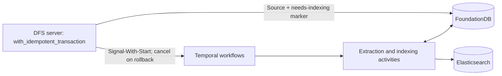

# dfs:// search proposal

## Targets

| Concern | Requirement |
| --- | --- |
| Latency | First useful result batch: p95 ≤350 ms, p99 <500 ms, including authorization and enabled rescoring under concurrent ingestion. Measure 20-hit completion separately. |
| Freshness | Ten seconds without another relevant change, then indexing within 30 minutes, including imports and fan-out. Continuously changing objects have no completion bound. Include ES refresh in lag measurements. |
| Delivery | Stream bounded result batches with backpressure, cancellation, and final completion status. |
| Outages | Continue filesystem writes during ES outages. Serve existing index; resume durable work after worker recovery. |
| Backlog | Alert on pending objects, Temporal backlog/failures, and source-to-searchable lag. Limit incoming work when storage cannot keep up. |

## Architecture

**Signal-With-Start MUST run inside `with_idempotent_transaction`, alongside the source mutation and its needs-indexing marker. On rollback, the transaction MUST cancel the Temporal workflow.** Dispatch must not be deferred until after commit.

**Debounce relevant `Apply` mutations per object with a 10-second buffer.** Each new mutation moves the processing deadline to its source-change timestamp +10 seconds. Signal-With-Start wakes an existing workflow or starts one; the workflow coalesces changes and processes the latest committed state after the buffer expires.



- Two workflow types: `preprocess` extracts text, then starts `indexFile`, which owns ES publication. Temporal owns waits, retries, progress, and worker recovery.
- Use separate Temporal task queues and independently sized worker pools for preprocessing and indexing so slow extractors cannot block direct text indexing.
- FDB owns source data, permissions, extraction generations, and a per-object needs-indexing marker.
- Preprocessing runs inside awaited activities. `preprocess` completes once text is durably stored and the `indexFile` start is acknowledged; it does not wait for indexing to finish. API adjustments follow separately.
- DFS owns orchestration and calls processors directly. Awaiting processor completion provides durable sequencing; the filesystem request waits for transaction-scoped dispatch, not for extraction or ES publication.

## Authorization

- Resolve accessible `root_ids` from direct user/group read grants in FDB before querying ES.
- Store one `root_id` per ES document: highest accessible parent. Read `DENY` stops inherited access.
- Store all strict `ancestor_ids`, including ancestors above a `DENY`. Folder scope is always recursive.
- Filter tenant, roots, scope, and metadata in ES. Check current permissions before returning each hit.
- Write-only grants confer no search visibility.
- Optional root cache: invalidate on grants, group membership, and relevant hierarchy changes.
- Ordinary grant changes require no descendant ES rewrites. Moves and read `DENY` changes do.

```text
foo              ALLOW g:engineering read
└── bar          DENY read
    └── reports  ALLOW g:finance read
        └── budget.pdf

budget.pdf: root_id = reports_id
            ancestor_ids = [foo_id, bar_id, reports_id]
```

- Finance can find `budget.pdf`, including under `foo`; engineering cannot inherit access through `bar`.
- Working assumption: fewer than 65k accessible roots per subject. Validate against tenant statistics.

## Elasticsearch documents

- One document per ordinary object; globally unique `_id` encodes `(tenant_id, object_id)` unambiguously.
- Aggregate native content or current extracted text into `text`. Extraction creates no separate ES document.
- Directories and files without available indexable text retain metadata-only documents.
- Explicit mappings; disable dynamic mapping.

| Field | Representation |
| --- | --- |
| `tenant_id`, `object_id` | Exact keywords. |
| `name` | Analyzed text plus exact keyword. |
| `kind`, `mime_type` | Keywords; normalize MIME type/subtype, e.g. `Text/Plain; charset=UTF-8` to `text/plain`. |
| `ancestor_ids` | Strict ancestor keyword array. |
| `root_id` | Single highest accessible parent keyword. |
| `size` | `unsigned_long`, in bytes. |
| `atime`, `mtime`, `ctime`, `created` | Optional `unsigned_long`, in milliseconds. |
| `xattrs` | Keyword array; encoding below. |
| `text` | Aggregate text with language-aware indexing as described below; empty for metadata-only objects. |
| `schema_version` | Rebuild compatibility. |

### Language-aware indexing

- Detect language from native or extracted text before ES publication. The meeting proposed a Google language-detection library; confirm the exact library, supported languages, and Rust integration before implementation.
- Support English and French language-specific fields/analyzers initially, with a neutral fallback for unsupported, uncertain, short, or mixed-language content. Final field names, confidence thresholds, and mixed-language handling belong in the mapping proposal.
- Query the supported language fields and fallback without requiring users to select a language. Define scoring and excerpt selection across fields in the mapping proposal; preserve the existing `NAME`/`CONTENT` distinction.
- Validate detection and relevance on representative English, French, mixed-language, and code-heavy files. Analyzer or mapping changes require a versioned index rebuild. The meeting's projected French share is not a measured sizing input.

### Xattr

- `K`: key with backslashes and `=` escaped. `V`: UTF-8 value with the same escaping.
- Every xattr emits `k:<K>` for existence. UTF-8 values also emit `v:<K>=<V>` for equality.
- Empty values emit `v:<K>=`. Binary values support existence only.
- Truncate `V` at a UTF-8 boundary to keep the complete token within 32,766 bytes. Apply identical query encoding.
- Truncated prefixes compare equal. No hash fallback or post-search equality check.
- FDB retains full values; retrieve through `Stat` with `include_metadata=true`.
- [Elasticsearch keyword limit](https://www.elastic.co/docs/reference/elasticsearch/mapping-reference/keyword).

## Index eligibility and updates

- Presence of `dfs.search.exclude`, including an empty value, excludes the object from all search.
- Directory exclusion applies to every descendant; children cannot override it. Removal re-enables indexing.
- Setting or removing exclusion creates subtree work where needed.
- MIME policy controls text indexing independently of exclusion. Only `text/*` MIME types are indexed natively; preserve their text without transformation.
- Eligibility follows the declared MIME type, not the filename extension. JSON, JavaScript, or TSX files are not exceptions: `application/json` is not indexed natively.

| MIME range | Text policy |
| --- | --- |
| `text/*` | Aggregate native content. |
| Binary MIME with configured extractor | Index metadata first; add matching extracted text when available. |
| Other MIME types | Metadata only. |

| Change | Indexing work |
| --- | --- |
| File bytes, attributes, xattrs | Rewrite current content and metadata. Extract again only when processor input/configuration changes; drop obsolete extracted text. |
| Extraction completed | `preprocess` starts `indexFile` to index the original document with extracted text. |
| User/group read grant | Update FDB grants and forward index; invalidate root cache. |
| File move | Recompute root and ancestry. |
| Read `DENY` insertion/removal | Recompute affected roots on object and descendants. |
| Directory move | Recompute roots and ancestry throughout subtree. |
| Directory rename | Rewrite its name only; paths are not indexed. |
| Directory metadata | Rewrite directory; traverse descendants only for inherited fields. |
| Object removal/replacement | Tombstone removed document; schedule parent metadata and replacement separately. |
| Current extraction removed | Clear current generation and rebuild without extracted text. |

## Temporal workflows

| Workflow | Input | Steps | Completion |
| --- | --- | --- | --- |
| `indexFile` | Native or extracted text, directories, metadata-only files, exclusions, removals. | Wait for stable input; read current state; write or tombstone ES document. Traverse descendants when required. | Required ES writes acknowledged; descendant work durably marked. |
| `preprocess` | MIME type with configured processor, e.g. PDF, DOCX, PPTX. | Wait for stable input; extract or reuse matching text; persist generation; start `indexFile`. | Complete text durably stored and `indexFile` start acknowledged. Processor acceptance alone never completes the workflow. |

### Deployment and signal volume

- Configure DFS Temporal namespaces, credentials, retention, and task-queue routing per deployment environment/region. Namespace provisioning and the initial indexing worker are implementation follow-ups.
- Debouncing reduces processing passes, not incoming signals or history events. Load-test bursts exceeding 1,024 mutations in 30 seconds on one object, including Continue-As-New and completion races. This is a meeting-reported workload, not a verified Temporal limit.
- Verify the deployed service's signal, history, and namespace rate limits; monitor throttling, dispatch latency, queue delay, and history growth. See [Temporal limits](https://docs.temporal.io/cloud/limits).
- Estimate Temporal cost from measured starts, signals, activities, timers, and retention. The meeting's $1,000/month/region figure is an estimate to validate, not a guaranteed ceiling.

### Start and reconcile

- Inside `with_idempotent_transaction`, mutate the source and update `search/dirty/<objectId>` under the tenant prefix: revision, change time, removal/traversal flags.
- Keep one marker per object; combine changes. Preserve removal state until the ES tombstone succeeds.
- **Before commit, await Signal-With-Start inside `with_idempotent_transaction`** for `indexFile` and, when extraction is needed, `preprocess`. `indexFile` publishes metadata while matching extracted text is unavailable; `preprocess` signals or starts it again when extraction completes. A dispatch failure fails the transaction; Temporal unavailability can block source writes, while ES unavailability does not.
- **On rollback, cancel the affected Temporal execution.** Provide this through an extension to `with_idempotent_transaction` or a higher-level helper built on it; target the execution so delayed cancellation cannot cancel a replacement run. Surface cancellation failures and retry cleanup.
- Keep the mutation identity stable across transaction retries. Resolve an ambiguous FDB commit through idempotency state before deciding to cancel; an unknown commit result is not a confirmed rollback.
- Activities must verify committed FDB state before extracting or publishing. A signal can arrive before commit; rolled-back mutations must never become indexing input.
- Use distinct IDs: `dfs-search/index/<tenantId>/<objectId>` and `dfs-search/preprocess/<tenantId>/<objectId>`. Only one execution of each workflow type runs per object. Ignore duplicate/older revisions; extraction completion must wake `indexFile` even when the source revision is unchanged.
- Periodically scan committed dirty markers in bounded batches and repair interrupted work using the same transaction-scoped dispatch and rollback rules. If rollback cancels a workflow that also held earlier committed work, the marker preserves that work for restart.
- FDB and Temporal cannot commit atomically. Markers and committed-state checks cover crashes where rollback compensation cannot run; reconciliation is a repair path, not normal post-commit dispatch.
- Keep the marker until `indexFile` publishes the required content successfully. Neither preprocessing completion nor metadata-only publication while extraction is pending clears it. Clear only the completed revision in a conditional FDB transaction; preserve concurrent changes.
- Before processing, recheck MIME/configuration. If preprocessing is no longer required, exit without clearing the marker; `indexFile` handles the current content policy. Reconciliation restarts preprocessing only when matching extracted text is missing; otherwise it starts indexing directly.
- Transient outages retain work. Terminal failures stay visible; retry unchanged terminal failures only through explicit repair.
- Build on the existing [`fdb::with_idempotent_transaction`](../server/src/storage/fdb.rs) and its [transaction receipts](STORAGE.md#transaction-receipts). Within the retry window, a committed receipt returns the saved result and original commit version without rerunning the body. The choice between extending this helper and adding a higher-level wrapper is an implementation detail; transaction-scoped Signal-With-Start, rollback cancellation, and the 10-second Apply debounce are required.

### Wait and retry

- Debounce relevant `Apply` mutations per object using a Temporal timer: processing starts no earlier than the latest source-change timestamp +10 seconds. A new mutation resets the deadline; duplicate or older signals do not extend it.
- For example, relevant Applies at 0s, 4s, and 9s produce one processing pass no earlier than 19s, using the latest committed state. The `preprocess` handoff to `indexFile` does not add another 10-second buffer unless a newer source mutation requires it.
- Recheck FDB revision before work. Newer changes restart the wait, including changes whose signal has not arrived.
- Count from nondecreasing server timestamps, never signal arrival. Clock skew limits timing accuracy.
- Ten seconds of silence does not prove upload completion. Clients need no publish marker; later writes trigger another pass.
- If input changes during processing, abandon the obsolete result and process current input after its wait.
- Workflow code stays deterministic; FDB, processor, and ES calls run in activities.
- Configure activity timeouts and exponential retries with a cap on the delay. Heartbeat long extraction/traversal activities; honor cancellation.
- Retry transient failures without requiring another file change. Invalid input remains a visible failure with its dirty marker intact.
- Keep only IDs, versions, and cursors in workflow history. Stream bytes inside activities; use Continue-As-New to bound long histories.
- Drain signals before completion/Continue-As-New; carry pending revision and traversal state forward. Reconciliation covers closing-run races.
- [Temporal activity retries and idempotency](https://docs.temporal.io/activity-definition), [Continue-As-New](https://docs.temporal.io/develop/typescript/workflows/continue-as-new).

## Preprocessing and storage

- One processor per MIME type. Configuration: `dfs-v1-{env}/search/processors/<mimeType>`, including version.
- Trusted activities read source storage and invoke the processor. Stream whole files with bounded buffers and backpressure.
- Call extractors such as Tika directly, or a dedicated processor endpoint for application-specific formats; use conversion services such as Gotenberg where needed. Front must not orchestrate each processing step.
- Run extraction locally or await/poll an existing processor job. The activity returns only after complete text is durably stored.
- Use a stable operation ID across activity retries; recover an existing processor job/output after ambiguous success.
- Validate source version across reads and before accepting output. Reuse extraction only when source and processor versions match.
- Metadata-only changes reuse valid text. Configuration changes mark affected sources through bounded rescans.
- Only `indexFile` calls ES publication activities. `preprocess` hands off through Signal-With-Start from an activity using `with_idempotent_transaction`, with cancellation on rollback.

### Frames and processor interface

- Define a versioned processor interface for MIME-based dispatch: source references and versions, processor configuration, complete text output, and retryable versus terminal errors. A manifest may declare this interface; its exact shape is a follow-up.
- Frames can contain a manifest and multiple files. Define the logical source object and input dependencies so a change to any processor input invalidates the extraction and restarts the 10-second debounce for that logical object.
- The frame processor interprets application-specific structure; DFS owns dispatch, durability, and storage. Decide which frame object owns the search hit and whether implementation files remain independently searchable, using the existing MIME and exclusion rules.
- Validate all input versions before accepting a compound result; retry if dependencies changed during extraction. The 10-second buffer does not prove a frame upload is complete, so later input writes must trigger another pass.

### Extracted-text storage

Tenant keys below omit `dfs-v1-{env}/tenant/<tenantId>/`:

| Key | State |
| --- | --- |
| `search/extraction/<objectId>/state` | Current complete generation and active extraction operation. |
| `search/extraction/<objectId>/generation/<generation>/metadata` | Operation ID, source/configuration versions, status, byte length, expiry. |
| `search/extraction/<objectId>/generation/<generation>/block/<blockIndex>` | Extracted text; ≤64 KiB per stored block. |

- Activities use existing FDB helpers. Each extraction attempt stages a private generation in bounded transactions; bytes never enter workflow history.
- The final `with_idempotent_transaction` validates source/configuration and active operation, marks complete, switches current generation, and awaits Signal-With-Start for `indexFile`. Rollback cancels the affected indexing execution. Retries reuse accepted output and safely repeat the handoff.
- `preprocess` then completes; `indexFile` runs independently. Recovery after text storage retries the handoff or indexing without extracting again.
- Incomplete or superseded attempts cannot publish. Complete generations are immutable and have no ordinary DFS objects, paths, xattrs, or grants.
- Indexer reads one fixed generation; validate current/input versions during reads and before preparing ES output. Restart on change.
- Cleanup runs in worker maintenance batches: mark unreferenced or expired incomplete generations deleting, then clear blocks and metadata.
- Preserve current complete output and active unexpired attempts. Fence expired attempts before deletion; late activity retries must restart safely.
- Reader losing a generation restarts; no reader pins. Source removal clears references after scheduling the ES tombstone.

## Indexing and backpressure

1. Read original metadata, current ancestry, permissions, and native/extracted text. Use bounded transactions; persist continuation.
2. Validate input versions across reads. Changed input follows the workflow's fresh-wait rule.
3. Allocate a monotonically increasing target publication revision after validating input. Persist immutable document bytes before sending.
4. Write to ES. Reject older revisions, including writes arriving after removal; retain revision-bearing tombstones.
5. Check every bulk-item result. Fail the activity on unsuccessful items; retry identical body/revision after ambiguous success. Release saved bytes after completion/abandonment.

- Bound activity concurrency, reads, aggregate buffered bytes, and in-flight ES requests. Size extraction and indexing worker capacity independently.
- Start with 2–8 MiB bulks and 30-second refresh. [Indexing guidance](https://www.elastic.co/docs/deploy-manage/production-guidance/optimize-performance/indexing-speed).
- Reduce active workers on 429s or rising search latency. Increase gradually when ES has capacity and indexing lags.
- Track dirty-marker age, Temporal task backlog, activity failures, and source-to-searchable lag. Metadata-only publication does not clear preprocessing work.

## Query path

1. Authenticate tenant/session; authorize requested scope.
2. Resolve accessible roots; select tenant index placement and routing.
3. Apply tenant, root, recursive ancestry, and metadata filters. Retrieve BM25 candidates; optionally rescore a bounded set.
4. Check current permissions before exposing titles or excerpts.
5. Stream authorized batches within [API limits](API.md#search). Report backend failure explicitly; stale index candidates remain possible.

API follow-up: align the processor contract and multilingual mapping with the search API. Resolve the freshness policy explicitly: the current [API proposal](API.md#search) suppresses stale indexed content and metadata, while this document currently specifies permission checks without the full freshness-validation mechanism.

## Implementation follow-ups

- Finalize the detector and multilingual mapping proposal, including query scoring and excerpts.
- Configure Temporal namespaces and separate worker queues; validate transaction rollback handling and signal bursts with the 10-second debounce.
- Define processor/manifest and frame contracts, then reconcile API documentation in the follow-up.
- Validate extraction retries, worker loss, ES outages, rollback cancellation, stale compound inputs, duplicate/reordered GCS events, and backfill racing with live writes/deletes.

## Tenant routing and shard layout

- Enable routing from the first document. Set `_routing.required=true`; pass `routing=tenant_id` for writes, reads, deletes, searches, and every bulk item.
- Persist tenant routing with workflow inputs and tombstones. Tenant filtering remains mandatory; routing does not isolate tenants.
- Start with a shared alias. Later resolve tenant index placement from cached FDB metadata and use its routing mode.
- Leave shared-alias routing unset. Data-stream use requires review and `allow_custom_routing`.
- `routing_partition_size=1`: single-shard routing. Otherwise require `1 < routing_partition_size < primary_count`; no `join` mappings.
- Example: 16 primaries, partition size 4; tenant spans four shards, `_id` selects each document's shard.
- [Routing](https://www.elastic.co/docs/reference/elasticsearch/mapping-reference/mapping-routing-field), [aliases](https://www.elastic.co/docs/manage-data/data-store/aliases).

### Measurements and benchmarks

- Collect per-tenant object counts by MIME type, bytes, and average/peak read/write rates. Budget collection time and GCS rate limits.
- Working load: interactive search over mostly stable files, mixed with imports, extraction completions, and subtree rewrites. Read/write ratio remains unmeasured.
- Benchmark 10, 25, 50, 100 GiB primaries using the same corpus and concurrent search/indexing load.
- Independently test primary counts, including 64/128 where volume supports them, and routing partition sizes 4/8.
- These are experiments, not startup settings. Elastic's 10–50 GB guidance is a starting point, not a hard limit.
- Large shards reduce overhead but can slow search/recovery; many small shards consume heap and coordination capacity.
- Whole-document replacement makes large-file updates expensive. Measure aggregated document throughput.
- [Shard sizing](https://www.elastic.co/docs/deploy-manage/production-guidance/optimize-performance/size-shards), [concurrency tradeoffs](https://www.elastic.co/blog/how-many-shards-should-i-have-in-my-elasticsearch-cluster).

| Workload | Benchmark hypothesis |
| --- | --- |
| Many concurrent searches | Low per-query shard fan-out. |
| Expensive queries on large tenants | Bounded shard parallelism may lower latency at throughput cost. |
| Heavy ingestion/replacement | Enough primaries for node parallelism; avoid splitting indexing buffers too far. |
