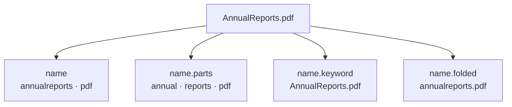

# Object search, with one file

We want to find files by words in their name, text, or saved attributes, like in Google Drive.
For example, `repo` should find Reports, and `type:pdf reports budget` should find a PDF about a budget.

This module defines the ES fields, the rules for processing text, and a command to create the empty index.
Sending files to ES, detecting languages, checking current permissions, and building queries come next.

The [mapping](indices/objects_1.mappings.json) lists the fields. The
[settings](indices/objects_1.settings.cell-00000.json) define how text is processed.
All cells use the same text rules.

Take this file:

```text
Name:           AnnualReports.pdf
Extracted text: Budget
MIME type:      application/pdf
```

One file becomes one ES document, meaning one search record with its name, text, and other fields.
Its storage blocks do not become separate results. Folders can have records too.

We send the name once. ES builds several ways to search it:



These fields let us search joined words, separate words, or the full name.
The original name stays `AnnualReports.pdf`. We keep `pdf` as a searchable word too.

The application queries will use these fields like this:

| Search | Why this file matches, or does not match |
| --- | --- |
| `repo` while typing | `reports` starts with `repo` in `name.parts` |
| `annualreports` | The complete joined word exists in `name` |
| `reports budget` | Reports is in the name and budget is in the text. Both words are required |
| `"annual reports"` | Annual and reports are next to each other in `name.parts` |
| `"annual report"` | No match. Quotes do not turn report into reports |
| `"reports budget"` | No match. A quoted phrase must stay inside one field |
| `type:pdf reports` | `kind=file` and `mime_type=application/pdf`, plus the word reports |
| `filename:"annualreports.pdf"` | The whole name matches `name.folded` |

Quotes require adjacent words in order, ignoring case and accents. Punctuation can separate words.
They are not byte-for-byte substring searches. For example, this analysis does not distinguish C++ from C#.

Stemming uses extra English/French fields so `running` can match `run`, or `journaux` can match `journal`.
Quotes and prefixes use words without stemming. ES does not detect the language for us.

<details>
<summary>The two tokenizers and all nine analyzers</summary>

A **token** is a searchable piece of text, usually a word. A **tokenizer** cuts text into pieces.
An **analyzer** runs several steps: change characters, cut words, then process the words.
A **normalizer** keeps a full value together, for example a filename or tag.

There are only two tokenizers:

| Tokenizer | What it does here |
| --- | --- |
| `icu_tokenizer` | Finds words in Unicode text, including languages without spaces between words. `journaux chevaux` gives `journaux`, `chevaux` |
| `whitespace` | Splits only at spaces. Keeps `AnnualReports.pdf` together for `dfs_name_parts` to cut at punctuation and capitals |

We need a filename recipe because a text tokenizer can keep a dotted name as one word.
For example, `dfs_text` produces `reports.pdf`, while `dfs_filename` produces `reports`, `pdf`.

“Store” means when a file is added to ES. “Search” means when ES processes a query.
Arrows show the words produced.

| Analyzer | Used for | Example |
| --- | --- | --- |
| `dfs_text` | Store and search body text, titles, descriptions, and searchable tag text without stemming | `L’avion des sociétés` → `l`, `avion`, `des`, `societes` |
| `dfs_filename` | Store `name`. Search both `name` and `name.parts` | `AnnualReports.pdf` → `annualreports`, `pdf` |
| `dfs_filename_parts` | Store `name.parts` and count name words | `AnnualReports.pdf` → `annual`, `reports`, `pdf` |
| `dfs_text_en` | Store and search English body text and text attributes | `ponies running reports` → `poni`, `run`, `report` |
| `dfs_text_fr` | Store and search French body text and text attributes | `L’avion des sociétés` → `avion`, `des`, `societ` |
| `dfs_filename_parts_en` | Store an English name in `stemmed.en.name` | `AnnualReports.pdf` → `annual`, `report`, `pdf` |
| `dfs_filename_parts_fr` | Store a French name in `stemmed.fr.name` | `journaux chevaux` → `journal`, `cheval` |
| `dfs_filename_en` | Search English names | `Reports.pdf` → `report`, `pdf` |
| `dfs_filename_fr` | Search French names | `journaux chevaux` → `journal`, `cheval` |

Name queries do not split on capitals, so `AnnualReports` and `annualreports` are cut the same way.
The query also checks the joined words in `name`. Stems such as `poni` and `societ` are used only
for matching. Users still see the original text. Common words such as `des` and `the` stay.

The normalizer is `dfs_folded`. It uses `icu_folding` without cutting the value into words.
`Réseau sécurité` becomes one value, `reseau securite`. This is used for whole tags and names.

These are the steps used inside those recipes:

| Step | What it does and why |
| --- | --- |
| `dfs_nfkc` | Makes Unicode forms consistent before cutting words. For example, the single character `fi` becomes `fi` |
| `dfs_filename_boundaries` | Changes dots and underscores to spaces. `Reports.pdf` gives two words |
| `dfs_apostrophe_boundaries` | Changes apostrophes to spaces so `avio` can find `l’avion` without knowing its language |
| `dfs_name_parts` | Uses `word_delimiter_graph` to cut at punctuation and capitals. `AnnualReports` gives `Annual`, `Reports`. Q4 stays together |
| `icu_folding` | Ignores case and accents. `Sociétés` becomes `societes` |
| `dfs_english_possessive` | Removes English possessive endings, such as the ending in `employee's` |
| `dfs_english_stem` | Uses Porter2: `running` → `run`, `reports` → `report` |
| `elision` | Removes an attached French article, such as `l’` in `l’avion`. Used for French body text and attributes |
| `dfs_french_stem` | Uses `light_french`: `journaux` → `journal` |
| `dfs_token_length` | Drops a token above 8,191 UTF-16 units after all changes, so one long string cannot make ES reject the file. Original text stays stored |

Every text analyzer starts with `dfs_nfkc` and ends with `dfs_token_length`.
Name parts are cut before folding removes capitals. French body analysis removes attached articles.
Filename analysis separates apostrophes. See the settings for the exact step order.

`index_prefixes` stores short word beginnings to speed up typing: 1–10 characters for names/titles,
1–5 for body/description/tags. There is no separate n-gram tokenizer. Longer prefixes search the
full words through a slower path that needs `search.allow_expensive_queries=true`.

We prefer this to a custom edge-ngram field because ES manages the extra prefix field and the
query rewrite. The main field keeps full words for ordinary and quoted searches. Both approaches
store word beginnings, so `index_prefixes` still costs disk space. It does not match inside a word.

Only the word still being typed gets a prefix match. Completed words can use stems.
For `report an`, report must match a whole word or stem, while an can match année.
Unquoted words can match different fields and in any order. Quotes keep them together.

</details>

<details>
<summary>Every field, with its purpose</summary>

`text` means searchable words. `keyword` means a whole value.
`_source` is the stored JSON, without the analyzed word lists.
Fields marked “source only” below cannot be used as search filters.

The name fields in the diagram and the following fields hold searchable text:

| Field | Purpose |
| --- | --- |
| `name` | Find complete filename words, including a joined word such as annualreports |
| `name.parts` | Also find individual words inside names such as AnnualReports |
| `name.keyword` | Match the original full filename exactly, including case and punctuation |
| `name.folded` | Match the full filename while ignoring case and accents |
| `content_text` | Search the complete extracted or native text of the file |
| `attributes.title` | Search a title when a file producer provides one |
| `attributes.description` | Search a description when provided |
| `attributes.tags` | Filter on a whole tag, ignoring case and accents |
| `attributes.tags.text` | Also find individual words inside tags |
| `name.token_count` | Name length after `dfs_filename_parts` analysis. AnnualReports.pdf counts 3, including pdf |
| `content_text.token_count` | Body length after `dfs_text` analysis |

ES builds name subfields, body token counts, and tag text automatically.
For language fields, the future DFS indexing code must send text explicitly:

| English field | French field | Text sent there |
| --- | --- | --- |
| `stemmed.en.name` | `stemmed.fr.name` | A name identified as that language |
| `stemmed.en.content_text` | `stemmed.fr.content_text` | Body text identified as that language |
| `stemmed.en.attributes.title` | `stemmed.fr.attributes.title` | A title identified as that language |
| `stemmed.en.attributes.description` | `stemmed.fr.attributes.description` | A description identified as that language |
| `stemmed.en.attributes.tags` | `stemmed.fr.attributes.tags` | Tag values identified as that language |

Detect each field separately. A French body does not make a short filename French.
Unknown language keeps normal word/prefix search. Always keep the full text outside `stemmed`.
Mixed-language blocks need separate detection and highlights, because their positions differ from the full body.

Separate fields keep their own match scores and lengths for a later ranking model.
No production field weights, freshness boost, or learning-to-rank model are added here.

The following fields identify the object and filter results:

| Field | Purpose |
| --- | --- |
| `tenant_id` | Which tenant owns the object. Every search must filter on it |
| `object_id` | Which DFS object to return |
| `kind` | `file` or `directory` |
| `is_deleted` | Exclude a deleted object while its search record is still present |
| `mime_type` | File format, such as `application/pdf`. `type:pdf` will use this and `kind=file` |
| `extension` | Filename extension, for a separate filter such as `ext:pdf` |
| `size_bytes` | File size in bytes |
| `attributes.owner_ids` | Producer-provided owner IDs, matched exactly |
| `attributes.source` | Producer-provided origin, such as gdrive, matched exactly |
| `xattr_names` | Names of stored xattributes, to test whether an attribute exists |
| `xattr_pair_hashes` | Hashes of attribute names and complete raw values, for equality filters. Their byte encoding remains to be defined |
| `ancestor_ids` | All parent folders up to the root, excluding this object. Used to search inside a folder |
| `read_grant_ancestor_ids` | Ancestors whose READ grants can give access, excluding this object. Stops at the closest read-DENY ancestor, including that ancestor. Empty when this object denies inherited read |

For example, if bar blocks inherited read access:

```text
foo → bar (DENY read) → folder123 (ALLOW finance read) → x.pdf

x.ancestor_ids            = [foo, bar, folder123]
x.read_grant_ancestor_ids = [bar, folder123]
```

Finance can find x under foo. A grant on foo cannot cross bar, but a grant on bar can give access.
Without a read-DENY, both ancestor lists are the same. A read-DENY on x empties its read-grant ancestors.
A write-only DENY does not shorten it. To include the searched folder itself, also check `object_id`.

The application will fetch current direct READ grants. A grant must match `object_id` for direct access,
or an ID in `read_grant_ancestor_ids` for inherited access. A grant on x still works when its ancestor
list is empty. The same applies to a tenant root, which has no ancestors.
No grants means no results. A failed lookup must not remove the filter. Recheck current permissions
before returning titles or text, and check folder scope after moves. Ordinary grant changes need no
descendant updates in ES. Moves and read-DENY changes can need them.

These fields hold dates and information for keeping the index up to date:

| Field | Purpose |
| --- | --- |
| `mtime_ms`, `created_at_ms` | Original modification/creation times as unsigned epoch milliseconds |
| `modified_at`, `created_at` | Those times as ES dates, for filters and possible later freshness scoring. Omit out-of-range dates |
| `ctime_ms`, `atime_ms` | DFS change/access times, source only. ctime is not creation time. DFS reads do not update atime |
| `attributes.source_modified_at` | Modification time from the original source, when available |
| `content_status` | Intended extraction status. Values remain to be defined |
| `attr_version`, `content_version` | DFS attribute/content versions, source only, to compare with DFS later |
| `text_source_object_id`, `text_source_content_version` | Intended extraction source/version, source only. Needs review before indexing because the newer extraction design uses private generations |

Xattributes are extra metadata stored as bytes. Only known attributes should fill `attributes.*`,
with source keys and decoding defined by the producer. `dynamic: strict` rejects unknown fields.
Keyword values need size checks, including the 32,766-byte limit after folding names/tags.
Omit oversized optional tags rather than cutting them into different values.

Word positions preserve phrase order. Character offsets locate highlights. A position gap of 100
keeps an adjacent phrase from crossing two array values. `_meta.schema_version` versions the mapping.

</details>

<details>
<summary>Tenant routing, cells, and creating the index</summary>

An index holds search records. ES divides it into shards. A replica is a copy of a shard.
The application will use `dfs.objects`, an alias pointing to the physical index `dfs.objects_1`.

The mapping requires `_routing`. Use `routing=tenant_id` for writes, reads, updates, deletes,
and tenant searches, including each bulk action. Use the authenticated tenant for requests and
the stored tenant for background work. The document `_id` is a unique tenant/object pair.
The shared alias has no fixed route.

Routing chooses shards. It does not check ownership or agreement with `_source.tenant_id`.
Tenants can share shards, so every search must still filter on `tenant_id`.

| Settings | Primaries | Shards per tenant search | Replicas per primary | Node placement |
| --- | ---: | ---: | ---: | --- |
| [local](indices/objects_1.settings.local.json) | 1 | 1 | 0 | No workload requirement |
| [cell-00000](indices/objects_1.settings.cell-00000.json) | 100 | 10 | 1 | Require `workload=filesystem` |
| [cell-00001](indices/objects_1.settings.cell-00001.json) | 100 | 10 | 1 | Require `workload=filesystem` |
| [cell-00002](indices/objects_1.settings.cell-00002.json) | 10 | 10 | 1 | Shared pool, no workload requirement |

Every production tenant uses ten physical primaries. In the small cell, that covers the whole index.
The large cells use `number_of_routing_shards=100` and `routing_partition_size=10`.
The small cell uses 50 routing slots, five per physical shard, and a partition of 49 slots.
That reaches all ten shards while keeping `routing=tenant_id`. ES 8.16 rejects a partition of ten
with ten routing slots. The [sharding note](../../../../x/flav/dfs-object-search/sharding.md)
explains the calculation and the live checks.

The 6–12 month sizing target is 100 GB per primary, with benchmarks at 120 GB.
Search latency and recovery time still need measurement at those sizes. Disk capacity must grow
with the index. One replica doubles stored bytes before keeping free space.
The current refresh interval is five seconds. Elasticsearch 8.16 with `analysis-icu` is required.
The Rust command embeds the JSON definitions. The DFS server does not create indices at startup.

From `dfs/server`, preview the complete creation request without contacting ES:

```sh
cargo run --bin elasticsearch_create_index -- --cell local
```

Create the index and its alias on a local cluster:

```sh
ELASTICSEARCH_URL=http://127.0.0.1:9200 \
  cargo run --bin elasticsearch_create_index -- --cell local --execute
```

For production, choose `--cell cell-00000`, `cell-00001`, or `cell-00002`, or set `CELL`.
Provide `ELASTICSEARCH_URL`, `ELASTICSEARCH_USERNAME`, and `ELASTICSEARCH_PASSWORD`.
Username and password must be supplied together. They are optional for an unsecured local cluster.
`ELASTICSEARCH_CA_CERT` can point to a PEM CA certificate. TLS certificate and hostname checks stay on.

The command checks that both names are unused, then creates the index and alias in one request.
A timeout or missing acknowledgement can leave the index created, so inspect ES before retrying.
It does not replace or migrate an existing index. Incompatible mapping changes need a new index and migration.

</details>

The word examples above come from the existing ES 8.16 + ICU
[mapping probe](../../../../x/flav/dfs-object-search/validate_mapping.py).
Keep them in step with the JSON definitions when changing analysis.
The [research notes](../../../../x/flav/dfs-object-search/README.md) retain the design choices and open work.
Run `cargo test --test search` from `dfs/server` for the bootstrap tests.
